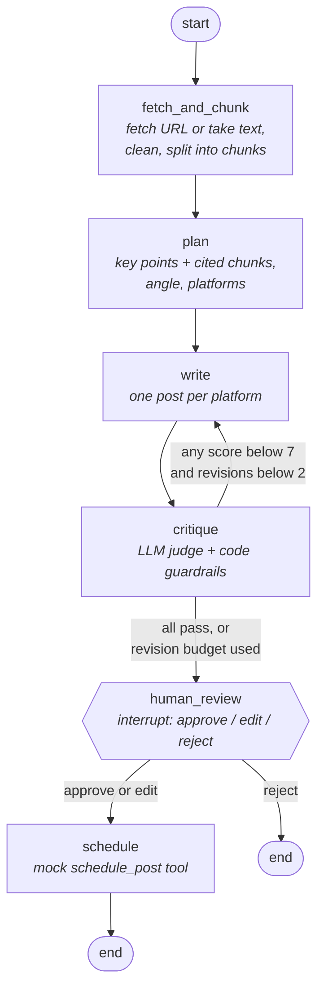

# Content-to-Post Agent

[](https://github.com/glitchvishal/content-to-post-agent/actions/workflows/ci.yml)

A LangGraph agent that turns an article (URL or text) into platform-ready **LinkedIn** and **X** posts, checks them with an LLM judge, rewrites the weak ones, and waits for a **human to approve** before anything is scheduled.

Built with Python 3.11, LangGraph, LangChain, OpenAI (`gpt-4o-mini` by default), Pydantic and FastAPI.

---

## The problem

Turning one good article into good social posts is slow, repetitive work. Generic AI writers make it fast, but they create new problems: invented facts, posts that break platform limits, bland openers, and nobody checking before it goes live.

This agent treats post generation as a small workflow with quality gates, not a single prompt:

1. **Ground** the posts in the source: every key point cites the chunk of the article it came from.
2. **Check** every post: an LLM judge scores faithfulness, platform fit and hook; code enforces hard limits.
3. **Fix** what fails: failing posts go back to the writer with the judge's feedback (max 2 rewrites).
4. **Keep a human in charge**: nothing is scheduled until a person approves, edits or rejects.

I built and run a GenAI content-to-social product in production. This project rebuilds the core idea as an explicit agent graph, so each step is inspectable, testable and measurable.

## Demo


<!-- Record a 20-30s GIF of `python -m agent run --url ...` (e.g. with https://github.com/charmbracelet/vhs or any screen recorder) and save it as docs/demo.gif. -->

## How it works



| Node | Job |
|---|---|
| `fetch_and_chunk` | Fetches the URL (retries, timeout, SSRF guard) or takes raw text, strips boilerplate, splits at paragraph > sentence > word boundaries. |
| `plan` | Structured output (Pydantic): 3-6 key points, each citing the chunk ids that support it, plus angle, audience and platforms. |
| `write` | One post per platform. On a revision pass, rewrites **only** the posts that failed, using the judge's feedback. |
| `critique` | LLM judge scores 1-10 on faithfulness, platform fit and hook. Code then caps scores for over-length posts and unsupported claims. |
| `human_review` | `interrupt()` pauses the run; the checkpointer saves it. Resume with approve / edit / reject. |
| `schedule` | Calls the mock `schedule_post` tool (writes to `data/scheduled_posts.json`). Idempotent; only reachable after approval. |

Every run tracks **revision count, token usage and cost** in the graph state. Details: [docs/ARCHITECTURE.md](docs/ARCHITECTURE.md). Product thinking: [docs/PRODUCT.md](docs/PRODUCT.md).

## Quick start

### Local

```bash
git clone https://github.com/glitchvishal/content-to-post-agent.git
cd content-to-post-agent
python3.11 -m venv .venv && source .venv/bin/activate     # Windows: .venv\Scripts\activate
pip install -r requirements-dev.txt
cp .env.example .env                                       # then put your OPENAI_API_KEY in .env

# Try it offline first (no API key, deterministic fake model):
python -m agent run --file evals/sample_article.txt --fake

# Real run on a URL; you will be asked to approve / edit / reject at the end:
python -m agent run --url https://example.com/some-article

# Other options
python -m agent run --text "Paste article text here..." --platforms linkedin
python -m agent graph            # print the graph as Mermaid
pytest                           # 24 tests, offline
```

### API

```bash
uvicorn api.main:app --reload
# Interactive docs: http://localhost:8000/docs
```

### Docker

```bash
cp .env.example .env             # add your OPENAI_API_KEY
docker compose up --build
# API on http://localhost:8000; scheduled posts land in ./data/scheduled_posts.json
```

## API examples

```bash
# 1. Start a run (returns immediately)
curl -s -X POST localhost:8000/runs \
  -H 'content-type: application/json' \
  -d '{"url": "https://example.com/some-article", "platforms": ["linkedin", "x"]}'
# -> {"run_id": "3f2c...", "status": "queued", "links": {"events": "/runs/3f2c.../events", ...}}

# 2. Watch progress live (Server-Sent Events). The stream ends when the run pauses for review.
curl -N localhost:8000/runs/$RUN_ID/events
# id: 2
# event: node
# data: {"node": "fetch_and_chunk", "elapsed_s": 0.84, "title": "...", "chunks": 4, ...}
# ...
# event: review_required
# data: {"posts": {...}, "critique": {...}}

# 3. Read status, posts, scores, revisions, tokens and cost
curl -s localhost:8000/runs/$RUN_ID

# 4a. Approve (optionally pick a time; timezone required)
curl -s -X POST localhost:8000/runs/$RUN_ID/review \
  -H 'content-type: application/json' \
  -d '{"decision": "approve", "schedule_at": "2026-11-10T09:30:00+05:30"}'

# 4b. Edit one post, then schedule
curl -s -X POST localhost:8000/runs/$RUN_ID/review \
  -H 'content-type: application/json' \
  -d '{"decision": "edit", "posts": {"x": "My own wording for the X post."}}'

# 4c. Reject (nothing is scheduled)
curl -s -X POST localhost:8000/runs/$RUN_ID/review \
  -H 'content-type: application/json' -d '{"decision": "reject", "reason": "Off-brand tone"}'
```

Status codes: `202` run started, `404` unknown run, `409` run is not awaiting review (e.g. reviewed twice), `422` invalid input (e.g. an edited X post over 280 characters).

Run statuses: `queued → running → awaiting_review → running → completed | rejected`, or `failed` with `{"type", "message", "node"}`.

## Sample output

From the offline demo mode (`--fake`), which shows the mechanics. The fake model deliberately writes a weak first hook so you can see the critique loop fire once:

```text
Run 3071590f-...  ·  model: fake (offline demo)
  ✓ fetch_and_chunk    0.0s  chunks=1, truncated=False
  ✓ plan               0.0s  angle=..., platforms=['linkedin', 'x'], key_points=4
  ✓ write              0.0s  written=['linkedin', 'x'], revision=0
  ✓ critique           0.0s  linkedin: F9 P8 H5 FAIL | x: F9 P8 H5 FAIL
  ✓ write              0.0s  written=['linkedin', 'x'], revision=1
  ✓ critique           0.0s  linkedin: F9 P8 H8 pass | x: F9 P8 H8 pass

── X (Twitter)  (76/280 chars)  faithfulness 9 · fit 8 · hook 8
A neighbourhood bakery sold its sourdough loaf for 120 rupees for two years.
   judge: Strong, specific opener and faithful to the source. Keep it.

[a]pprove / [e]dit / [r]eject? a
  ✓ human_review       0.0s  decision=approve
  ✓ schedule           0.0s  scheduled=[{'platform': 'linkedin', ...}, {'platform': 'x', ...}]

Status: completed  ·  revisions: 1  ·  LLM calls: 9  ·  tokens: 6137 in / 647 out  ·  cost: $0.0013
```

<!-- TODO: replace with the output of a real run (python -m agent run --url ...) once you have an API key set. -->

## Evals

`evals/dataset.json` holds 10 short self-written articles with concrete numbers (so invented or changed facts are easy to spot) and one adversarial article with a hidden prompt-injection line.

```bash
python evals/run_evals.py            # real model; ~10 runs, a few cents with gpt-4o-mini
python evals/run_evals.py --limit 3  # quick check
python evals/run_evals.py --fake     # offline: tests the harness, not quality
```

It runs the full graph with auto-approve and writes [`evals/results.md`](evals/results.md): per-article scores, first-draft vs final averages, pass rate, revision rate, prompt-injection violations, latency and cost.

| Metric (gpt-4o-mini, 10 articles) | Result |
|---|---|
| Pass rate: first draft → final | _run evals_ |
| Faithfulness: first draft → final | _run evals_ |
| Platform fit: first draft → final | _run evals_ |
| Hook: first draft → final | _run evals_ |
| Revision rate | _run evals_ |
| Prompt-injection violations | _run evals_ |
| Avg latency / cost per run | _run evals_ |

<!-- Fill this table from evals/results.md after running `python evals/run_evals.py` with your OpenAI key. -->

## Design decisions

- **A graph, not a chain.** The critique → rewrite loop and the human pause are real control flow. LangGraph makes them explicit edges with saved state, instead of `while` loops and globals around a chain.
- **Grounding by citation.** The planner must cite chunk ids for every key point. The writer only sees those chunks; the judge checks against the same chunks.
- **Judge + code, not judge alone.** LLMs cannot count characters reliably, so length is enforced in code. Any unsupported claim the judge lists caps faithfulness below the pass mark.
- **A bounded loop.** At most 2 rewrites, and only failing posts are rewritten and re-judged. That caps cost and latency per run.
- **The human sits right before the side effect.** Review happens after the automatic quality loop (so humans see the best draft) and before scheduling (the only irreversible step).
- **Checkpointer.** `MemorySaver` persists state after every node, which is what makes `interrupt()` and resume work. Swapping in Postgres is a one-line change.
- **JSON-only state.** Pydantic validates LLM output at the boundary; the state stays plain JSON so any checkpointer can store it and the API can return it as-is.
- **Typed errors and retries.** Transient failures (timeouts, 429, 5xx, malformed structured output) retry with exponential backoff; permanent ones (404, bad key, too-short article) fail fast with a clear message and the node that failed.

## Project structure

```
agent/
  graph.py        StateGraph wiring, checkpointer, progress summaries
  nodes.py        the 6 nodes, routing functions, guardrails
  state.py        AgentState TypedDict with reducers for usage and history
  schemas.py      Pydantic models for structured LLM output
  prompts.py      all prompts
  llm.py          OpenAI client: retries, timeouts, token + cost tracking
  fake_llm.py     deterministic offline test double
  fetch.py        fetching, HTML cleaning, chunking, SSRF guard
  review.py       human review contract and validation
  tools.py        mock schedule_post tool
  platforms.py    LinkedIn and X rules
  __main__.py     CLI
api/              FastAPI app and run manager (SSE)
evals/            dataset, runner, results
tests/            24 offline tests (fetching, graph paths, routing, API)
docs/             architecture, product, interview notes
```

## Limitations

- **In-memory checkpointer:** runs waiting for review are lost when the API restarts.
- **Single process:** runs execute in threads in the API process; no queue or horizontal scaling yet.
- **The judge is an LLM.** Scores are a useful regression signal, not ground truth; by default it is the same model that wrote the post (set `JUDGE_MODEL` to use another).
- **Character counting** uses Python `len`. X counts some characters (emoji, URLs) differently.
- **Fetching** works for server-rendered pages. JavaScript-heavy or paywalled pages need the text pasted in.
- **Long articles** are cut to a context budget (`MAX_SOURCE_CHARS`); the state flags `source_truncated`.
- **Scheduling is a mock:** it writes to a JSON file. No auth, no real publishing.

## Next steps

- `PostgresSaver` checkpointer + a job queue so paused runs survive restarts and work spreads across workers.
- Parallel per-platform writing and judging with LangGraph's `Send` API.
- "Reject with feedback" that routes back to `write` instead of ending.
- Real publishing via LinkedIn / X APIs (OAuth per user, rate limits, idempotency keys, a publish queue with retries).
- A small review UI on top of the SSE stream.
- Calibrate the judge against a small set of human-labelled posts; track eval scores in CI on every prompt change.

## License

MIT © Vishal Kumar Singh
